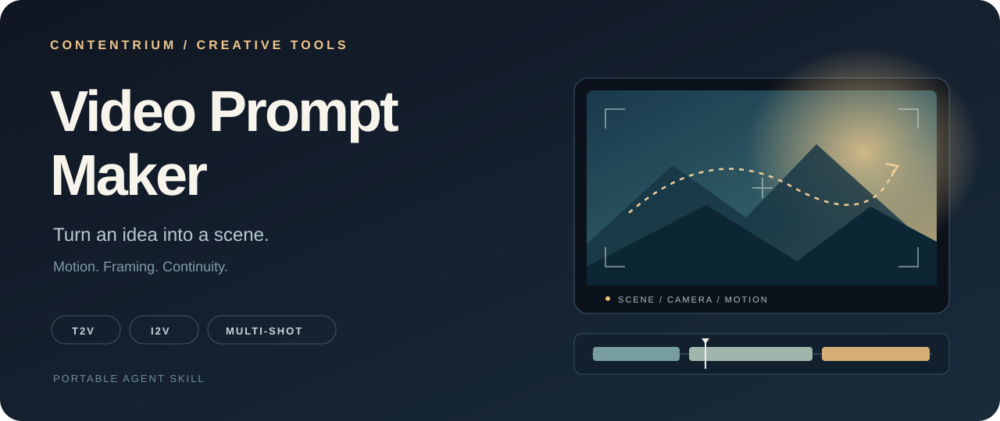
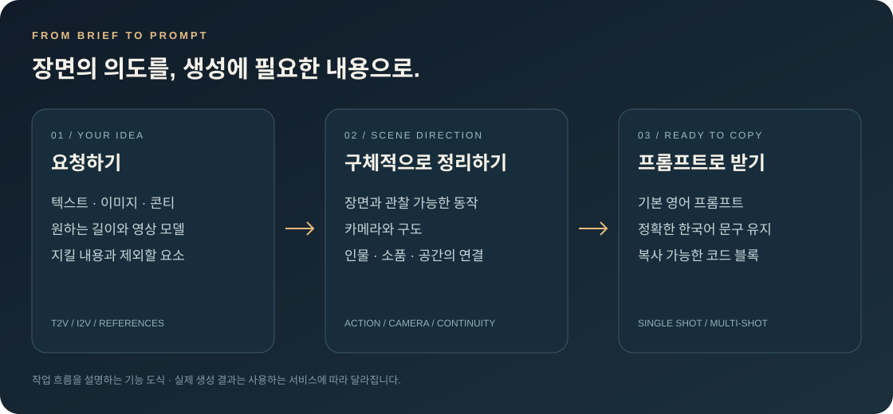

<p align="center">
  
</p>

<h1 align="center">Video Prompt Maker</h1>

<p align="center">
  <strong>떠오른 장면을, 바로 사용할 수 있는 영상 프롬프트로.</strong><br>
  콘텐츠리움이 장면·동작·카메라·연속성을 정리해 만든 영상 생성 프롬프트 스킬입니다.
</p>

<p align="center">
  <a href="#적용-범위와-제한"></a>
  <a href="https://github.com/contentriumkorea/video-prompt-maker/releases/latest"></a>
  <a href="https://contentrium.com/"></a>
</p>

<p align="center">
  <a href="#빠르게-시작하기"></a>
  <a href="https://github.com/contentriumkorea/video-prompt-maker/releases/latest"></a><br>
  <a href="#사용-모습">사용 모습</a> · <a href="USAGE.md">상세 안내</a>
</p>

---

## 빠르게 시작하기

Agent Skills를 지원하는 AI 도구에서 사용하세요. 아래 선택형 설치 명령은 Node.js·npm이 이미 설치된 환경에서 실행합니다.

```sh
npx skills add contentriumkorea/video-prompt-maker --skill video-prompt-maker
```

설치할 도구를 직접 선택한 뒤, 해당 도구를 다시 불러오세요. 이 명령은 선택 사항인 커뮤니티 설치 도구입니다. 명령을 사용하지 않으려면 [최신 ZIP](https://github.com/contentriumkorea/video-prompt-maker/releases/latest)을 내려받아 `video-prompt-maker` 폴더를 해당 도구의 스킬 폴더에 복사하세요.

[상세 설치 및 업데이트 안내 →](USAGE.md#install-manually)

## 영상 프롬프트에 필요한 흐름을 한 번에

| 01 · 장면과 동작 | 02 · 카메라와 연속성 | 03 · 다양한 입력과 전달 |
| :--- | :--- | :--- |
| **머릿속 장면을 구체적인 행동으로** | **보여줄 순서와 시점을 명확하게** | **작업 방식에 맞는 프롬프트로** |
| 피사체의 동작, 주변 환경, 인물의 관찰 가능한 연기를 정리합니다. | 샷별 카메라와 구도를 정리하고 인물·소품·공간의 연결을 점검합니다. | 텍스트·이미지·참고 자료·멀티샷 요청을 다루고, 복사 가능한 프롬프트로 전달합니다. |

## 사용 모습

<p align="center">
  
</p>

**짧은 요청에서 시작해, 영상 생성에 필요한 내용을 순서대로 정리합니다.**

위 이미지는 스킬의 작업 흐름을 설명하는 기능 도식입니다. 완성된 프롬프트는 기본적으로 영어로 작성하고, 사용자가 지정한 한국어 대사와 화면 문구는 유지합니다.

<details>
<summary><strong>추가 예시 보기</strong></summary>

| 하고 싶은 작업 | 요청 예시 |
| :--- | :--- |
| 사진을 움직이는 장면으로 | “첨부 이미지의 인물과 구도를 유지하면서 자연스럽게 움직이는 영상 프롬프트로 작성해줘.” |
| 여러 장면을 이어 구성 | “이 콘티를 샷별 영상 프롬프트로 정리해줘. 인물과 소품이 이어지도록 해줘.” |
| 기존 프롬프트 다듬기 | “카메라 지시가 겹치는 부분과 공간 관계를 점검하고, Kling 4.0용 프롬프트로 다듬어줘.” |

</details>

## 스킬 설치와 웹 도구 사용

| 방식 | 사용 방법 |
| :--- | :--- |
| **Agent Skills 지원 도구** | Claude Code·Cursor·Gemini CLI·Codex·GitHub Copilot·Windsurf용 [폴더 설치 안내](USAGE.md#install-manually)를 확인하세요. |
| **Claude 웹** | 계정에서 Skills 업로드 기능을 사용할 수 있다면 최신 ZIP을 업로드하세요. |
| **Gemini CLI** | 저장소에서 직접 설치하거나 최신 `.skill` 파일을 사용하세요. |
| **Gemini Gems 등 웹 도구** | 최신 **Web Instructions.md**의 짧은 설정 문구를 지침에 넣고, 같은 파일 전체를 지식·참고 자료로 첨부하세요. |
| **기존 설치 업데이트** | 새 패키지의 `video-prompt-maker` 폴더로 설치본을 교체한 뒤 도구를 다시 불러오세요. 웹 도구는 첨부 지침서도 교체하세요. |

최신 릴리스에서 **ZIP · .skill · Web Instructions.md · 체크섬**을 함께 제공합니다. 파일명에는 제작 시각이 들어가며, GitHub에서는 공백과 일부 기호가 점으로 바뀔 수 있습니다. ZIP 내부에는 `video-prompt-maker/SKILL.md`가 바로 보이는 한 개의 스킬 폴더가 있습니다.

## 이렇게 사용하세요

```text
첨부한 이미지를 바탕으로 10초짜리 영상 생성 프롬프트를 작성해줘.
인물과 의상, 배경 구도는 유지하고 카메라는 천천히 가까워지게 해줘.
화면에 들어갈 문구는 “새로운 시작” 그대로 유지해줘.
```

사용할 영상 모델, 길이, 참고 이미지의 역할, 꼭 지켜야 하는 문구와 제외할 내용을 함께 적으면 요청을 더 명확하게 전달할 수 있습니다.

## 적용 범위와 제한

영상 생성용 프롬프트를 작성·수정·검토하는 스킬입니다. 영상 모델의 지원 입력과 실제 생성 결과는 사용하는 서비스에 따라 달라집니다. Agent Skills 자동 인식·사용 가능 여부는 각 AI 도구와 계정 설정을 확인하세요.

프롬프트 검사에는 Python 3.10 이상이 필요합니다. 코드 실행이 없는 웹 환경에서는 전체 지침서를 읽을 수 있어야 하며, 실행하지 않은 검증 결과를 통과했다고 표시하지 않습니다.

<details>
<summary><strong>상세 안내와 검증 범위</strong></summary>

[상세 설치·검증·유지관리 안내](USAGE.md)에서 설치 폴더, Gemini CLI 명령, 검증 방법과 공식 참고 문서를 확인할 수 있습니다.

스킬 패키지 구조, 원본 파일 보존, 전체 지침서 출력, 체크섬 및 프롬프트 검증 코드를 테스트합니다. 패키지 검증과 각 서비스 안에서의 실제 동작 검증은 구분합니다.

별도 라이선스는 명시되어 있지 않습니다. 사용·재배포 조건은 [콘텐츠리움](https://contentrium.com/)에 문의하세요.

</details>

<details>
<summary><strong>English overview</strong></summary>

Video Prompt Maker is a portable Agent Skill by Contentrium for creating, refining, and reviewing video-generation prompts. It organizes subjects, motion, environment, camera direction, visual style, and continuity, while preserving exact supplied Korean dialogue and on-screen text.

Use a native skill folder where Agent Skills are supported, a ZIP for supported web uploads, a `.skill` archive for Gemini CLI, or the complete Web Instructions file for instructions-only tools. Host support and code execution depend on the tool and account.

</details>

---

<p align="center">
  <strong>Contentrium · 콘텐츠리움</strong><br>
  <a href="USAGE.md#이용-조건">이용 조건</a> ·
  <a href="https://github.com/contentriumkorea/video-prompt-maker/releases/latest">Latest release</a>
</p>

<sub>© Contentrium. 각 AI 도구의 명칭과 상표는 해당 권리자에게 있습니다.</sub>

<p align="center">
  <a href="https://contentrium.com/"></a>
</p>
